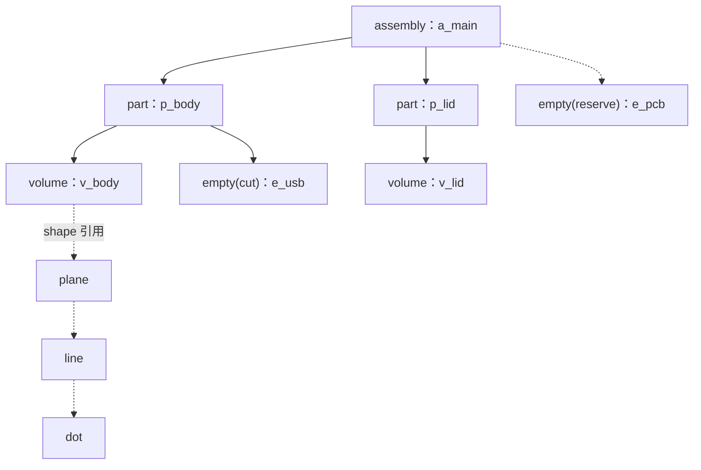
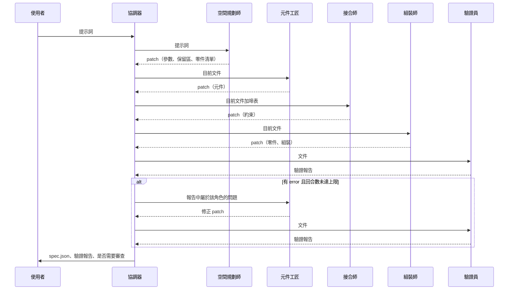

# 維度階梯（Dimensional Ladder）— 概念與技術設計

> 狀態：設計草案（尚未實作）；**階段 0 規格凍結已完成（2026-11-26）**，凍結規格見 [`CAD_DSL_2.md`](CAD_DSL_2.md)，§14.4 的審查事項皆已處理。本文與 `CAD_DSL_2.md` 衝突時，以 `CAD_DSL_2.md` 為準；本文保留設計理由與端到端敘事。適用對象：PromptCAD Studio v0.1.0 之後的演進。
> 本文所有「現況」敘述均以 v0.1.0 原始碼為準（`app/models/cad.py`、`app/services/planners/intent.py`、`app/services/validator.py`、`app/services/compiler.py`）；所有「2.0」敘述均為提案，標示「提案」的檔名、欄位與環境變數目前都不存在。依 [ADR 0010](adr/0010-migration-phases.md)，2.0 在第 2 階段以 Rust core 實作，本文提及的 `app/models/cad2.py`、`app/services/migrate.py`、`app/services/solver.py` 等 Python 提案檔名已作廢。

---

## 1. 願景與一句話定義

**一句話定義：** 維度階梯是一套以「空、點、線、面、體」五種原語元件為唯一建材，由多個 AI agent 以「升維、接合、約束」三類操作把它們組裝成成品，並由確定性幾何核心負責產出 STEP／STL／DXF 的 CAD 系統。

| 項目 | 建議 |
|---|---|
| 概念名稱 | 維度階梯 Dimensional Ladder |
| 中介格式 | CadDocument 2.0（沿用 `spec.json` 檔名） |
| 五原語統稱 | 元件（component），`kind` ∈ `empty` / `dot` / `line` / `plane` / `volume` |
| 三類操作 | 升維 promote、接合 join、約束 constrain |
| 口號 | 先留空，再落實（Reserve first, realize later） |

v0.1.0 的流程是「一句話 → 一個樣板零件」：`LLMIntent` 只能選 `plate`、`cylinder`、`ring`、`l_bracket`、`enclosure` 其中一個 `template`，`CadDocument` 1.0 只有單一 `base` 加上 `holes`、`fillets`、`chamfers`。它可靠，但表達力的上限就是樣板的數量。

維度階梯要改變的是表達力的來源：不再靠增加樣板，而是靠少數原語的組合。樣板不會消失，它們降級為「常用組合的捷徑」。

**不變的原則：** LLM 永遠不輸出可執行程式碼；驗證閘門出現 `error` 就不啟動 renderer；同一份 `spec.json` 永遠產生同一份 `model.py`。

---

## 2. 核心哲學：從「無」到「體」

### 2.1 階梯


實線是升維，虛線是降維或落實。階梯是一個環：體取反成為空，空被落實後又成為體的一部分（或從體中被減去）。

### 2.2 各維度的定義與語意

| 原語 | 維度 | 幾何意義 | 設計語意 | v0.1.0 的對應 |
|---|---|---|---|---|
| 空 Empty | ∅ | 一個有形狀、沒有材料的區域 | 設計意圖：這裡要留給誰、誰不准進來、要從誰身上挖掉 | 隱含：孔的切刀圓柱、`enclosure` 的 `inner` 盒 |
| 點 Dot | 0D | 一個位置 | 定位基準：孔心、角點、安裝點 | 隱含：`HoleFeature` 的 `x`、`y`、`z`，不是實體 |
| 線 Line | 1D | 線段、折線、圓弧、圓 | 路徑與輪廓邊界 | 無 |
| 面 Plane | 2D | 由封閉線圍成的區域 | 截面、草圖、接合面 | 隱含：`cq.Workplane('XY').circle(...)` 這類編譯器內部輪廓 |
| 體 Volume | 3D | 有材料的實體 | 零件的實體部分 | `base` 的五種型別，每份文件只能一個 |

### 2.3 為什麼「空」是一等公民

傳統 CAD 的建模順序是先有實體再挖洞，「這個空間要留給電路板」這類意圖只存在設計者腦中，或寫在註解裡。v0.1.0 也一樣：孔在 `compiler.py` 內是 `hole_{index} = cq.Solid.makeCylinder(...)` 再 `result.cut(...)`，外殼內腔是 `outer.cut(inner)`，這些「空」都只是編譯過程的中間變數，在 `spec.json` 中沒有身分。

把空提升為元件，有四個具體好處：

1. **agent 可以先做空間規劃。** 「在這裡保留 80×50×25 的區域給 PCB」是第一個回合就能寫下的事實，此時還沒有任何實體。後續 agent 都必須尊重它。
2. **意圖可以被機器檢查。** 保留區被實體侵入、禁入區被穿越、減除區沒有切到任何東西，都能變成有代碼的驗證問題，回饋給 agent 修正。
3. **衝突時有明確的讓步規則。** 本設計規定「空優先於實」：使用者指定的保留區不可被縮小，agent 只能調整實體去容納它（見 12.2 範例）。
4. **孔、槽、內腔、間隙、包絡統一成同一種東西。** 它們只是 `role` 不同的空。

空的四種角色（`role`，封閉列舉）：

| `role` | 語意 | 是否參與布林 | 驗證 |
|---|---|---|---|
| `cut` | 從所屬零件減除（孔、槽、內腔） | 是，`cut` | 必須與目標實體相交，否則 `empty_cut_no_effect` |
| `reserve` | 保留給特定內容物（PCB、電池、手指） | 否 | 任何實體不得侵入，否則 `reserve_violated` |
| `keep_out` | 禁入區（刀具路徑、散熱風道、運動行程） | 否 | 同上，代碼 `keep_out_violated` |
| `envelope` | 包絡上限（成品不得超出的外框） | 否 | 所有實體必須完全在內，否則 `envelope_exceeded` |

---

## 3. 元件模型

### 3.1 共通欄位

每個元件都是一筆有穩定身分的資料：

| 欄位 | 型別 | 說明 |
|---|---|---|
| `id` | `^[a-z][a-z0-9_]{0,31}$` | 文件內唯一，建立後不可改名 |
| `kind` | `empty` / `dot` / `line` / `plane` / `volume` | 判別欄位 |
| `shape` | 依 `kind` 而定的判別聯集（以 `shape.kind` 判別） | 形狀與數值參數 |
| `label` | `str \| None`，最長 80 | 給人看的名稱，不產生識別字或程式邏輯（只隨內嵌的 `CAD_SPEC` JSON 出現，見 10.1） |
| `provenance` | `{agent, patch_id}` | 由協調器蓋章，agent 不能自己寫（原名 `origin`，因與埠名 `origin` 衝突而改名，見 [`CAD_DSL_2.md` §3.1](CAD_DSL_2.md#31-共通欄位)） |

三個刻意的設計決定：

- **元件不帶座標。** 位置完全由約束層決定（第 5 節），求解結果寫入獨立的 `resolved.json`，不寫回 `spec.json`。這樣 `spec.json` 只記錄意圖，改一個參數不必手動改一串座標。
- **埠（port）不由 agent 宣告。** 每種 `shape.kind` 有一張固定的埠表，由程式推導（提案：`app/services/ports.py`）。agent 只能引用，不能發明。引用語法為 `元件id.埠名`，例如 `v_plate.top`；欄位引用則用 `元件id:欄位名`，例如 `v_body:height`（凍結規格見 [`CAD_DSL_2.md` §1.3、§3.4](CAD_DSL_2.md#13-引用語法)）。
- **形狀欄位只放數值。** 參數化關係放在文件層的 `bindings`（3.7 節），不把運算式塞進形狀欄位。這讓 1.0 的 `PlateBase`、`CylinderBase`、`RingBase`、`LBracketBase`、`EnclosureBase` 可以原封不動當作 Volume 的 `shape` 重用。

### 3.2 埠的四種型別

| 埠型別 | 幾何內容 | 例子 |
|---|---|---|
| `point` | 一個位置 | `d_h1.point`、`v_plate.center` |
| `axis` | 一個位置加一個方向 | `v_post.axis`、`e_h1.axis` |
| `face` | 一個平面（原點、法向、u／v 方向、範圍） | `v_plate.top`、`v_body.cavity_floor` |
| `region` | 一個三維範圍（軸對齊包圍盒加形狀引用） | `e_pcb.region`、`v_body.cavity` |

### 3.3 空 Empty

| `shape.kind` | 參數 | 埠 |
|---|---|---|
| `box` | `length`、`width`、`height` | `origin`(point)、`center`(point)、`axis_z`(axis)、`top`／`bottom`／`x_pos`／`x_neg`／`y_pos`／`y_neg`(face)、`region` |
| `cylinder` | `diameter`、`height` | `origin`、`center`、`axis`、`top`、`bottom`、`region` |
| `hole` | 1.0 `HoleFeature` 去掉 `x`、`y`、`z` 後的全部欄位（`axis`、`diameter`、`hole_type`、`depth`、`thread`、`counterbore_*`、`countersink_*`） | `entry`(point)、`axis`(axis)、`region` |
| `of` | `source`：一個 Volume 的 `id`（體取反） | 沿用來源的埠 |

可用操作：`realize`（把 `reserve` 落實為 `cut` 或標記為已被某零件佔用）、被 `cut` 使用。

```json
{
  "id": "e_pcb",
  "kind": "empty",
  "role": "reserve",
  "shape": {"kind": "box", "length": 80, "width": 50, "height": 25},
  "label": "PCB 與其上元件的保留空間"
}
```

```json
{
  "id": "e_h1",
  "kind": "empty",
  "role": "cut",
  "shape": {
    "kind": "hole", "axis": "z", "diameter": 6.6, "hole_type": "clearance",
    "depth": null, "thread": "M6",
    "counterbore_diameter": null, "counterbore_depth": null,
    "countersink_diameter": null, "countersink_angle": null
  }
}
```

### 3.4 點 Dot

| `shape.kind` | 參數 | 埠 |
|---|---|---|
| `point` | 無 | `point` |

Dot 沒有尺寸，全部資訊來自約束。可升維：兩個以上的 Dot 以 `connect` 成為 Line。

```json
{"id": "d_h1", "kind": "dot", "shape": {"kind": "point"}, "label": "左下角孔心"}
```

### 3.5 線 Line

| `shape.kind` | 參數 | 埠 |
|---|---|---|
| `segment` | `start`、`end`（Dot 的 `id`） | `start`、`end`、`mid`(point)、`axis` |
| `polyline` | `points`（Dot `id` 清單，2–64 個）、`closed` | `start`、`end`(point) |
| `arc` | `start`、`through`、`end`（Dot `id`） | `start`、`end`、`center`(point) |
| `circle` | `center`（Dot `id`）、`diameter` | `center`(point)、`axis` |

可升維：封閉的 `polyline`、`circle` 以 `close` 成為 Plane。未封閉的線在 2.0 只作為參考與旋轉軸使用。

```json
{
  "id": "l_outline", "kind": "line",
  "shape": {"kind": "polyline", "points": ["d_a", "d_b", "d_c", "d_d"], "closed": true}
}
```

### 3.6 面 Plane 與體 Volume

**Plane：**

| `shape.kind` | 參數 | 埠 |
|---|---|---|
| `rect` | `length`、`width` | `center`(point)、`normal`(axis)、`face`(face) |
| `disc` | `diameter` | 同上 |
| `profile` | `outer`（封閉 Line 的 `id`）、`inners`（封閉 Line `id` 清單，最多 16） | 同上 |
| `section` | `source`（Volume `id`）、`offset`（降維：取截面） | 同上 |

可升維：`extrude`、`revolve` 成為 Volume。Plane 也是 DXF 輸出的直接來源。

**Volume：**

| `shape.kind` | 參數 | 說明 |
|---|---|---|
| `plate`、`cylinder`、`ring`、`l_bracket`、`enclosure` | 與 1.0 的 `PlateBase` 等完全相同 | 捷徑原語，等價於一條升維鏈 |
| `extrude` | `profile`（Plane `id`）、`height` | 面沿法向拉伸 |
| `revolve` | `profile`（Plane `id`）、`axis`（`segment` Line `id`）、`angle`（0 < angle ≤ 360） | 面繞軸旋轉 |

Volume 的埠（以 `plate` 為例，其餘盒狀形狀相同）：`origin`（底面中心，沿用 1.0「原點位於零件 XY 中心、底面 Z=0」的慣例）、`center`、`axis_z`、`top`、`bottom`、`x_pos`、`x_neg`、`y_pos`、`y_neg`、`region`。`enclosure` 另有 `cavity_floor`(face，位於 `z = wall_thickness`、法向 +Z) 與 `cavity`(region)。`cylinder`、`ring` 有 `axis`、`top`、`bottom`、`center`。

捷徑原語的等價升維鏈（由正規化器展開，僅供驗證與教學，不強制展開儲存）：

| 捷徑 | 等價鏈 |
|---|---|
| `plate` | `rect` 面 → `extrude(thickness)` |
| `cylinder` | `disc` 面 → `extrude(height)` |
| `ring` | `profile(outer=circle, inners=[circle])` → `extrude(height)` |
| `l_bracket` | 兩個 `plate` 以 `add` 合併 |
| `enclosure` | `plate` 外盒，再 `cut` 一個 `box` 空 |

```json
{"id": "v_plate", "kind": "volume",
 "shape": {"kind": "plate", "length": 120, "width": 60, "thickness": 10}}
```

```json
{"id": "v_rib", "kind": "volume",
 "shape": {"kind": "extrude", "profile": "f_rib", "height": 4}}
```

### 3.7 具名參數與綁定

```json
{
  "parameters": [
    {"name": "wall", "value": 2, "min": 0.8, "max": 10, "note": "壁厚"},
    {"name": "standoff_h", "value": 5, "min": null, "max": null, "note": "PCB 底面離內底高度"},
    {"name": "pcb_stack", "value": 25, "min": null, "max": null, "note": "PCB 連同元件高度"}
  ],
  "bindings": [
    {"target": "v_body:height", "expr": "wall + standoff_h + pcb_stack + 1"}
  ]
}
```

- `target` 的語法是 `元件id:欄位名` 或 `約束id:欄位名`（凍結時由 `.` 改為 `:`，以區分埠引用，見 [`CAD_DSL_2.md` §1.3](CAD_DSL_2.md#13-引用語法)）。
- `expr` 的文法是封閉的：數字、參數名、`元件id:欄位名`、`+ - * /`、單元負號、括號、`min()`、`max()`（EBNF 見 [`CAD_DSL_2.md` §4.3](CAD_DSL_2.md#43-運算式文法封閉)）。由自寫的遞迴下降解析器求值（在 Rust core 實作），不使用 `eval`。
- 被綁定的欄位仍保留一個數值作為快取。正規化器每次重算並覆寫；循環依賴回報 `binding_cycle`。

---

## 4. 操作代數

所有操作都是封閉詞彙。agent 只能從下表選用，不能創造新動詞。

### 4.1 升維 promote

| 操作 | 輸入 → 輸出 | 在文件中的表現 |
|---|---|---|
| `connect` | Dot × n → Line | 新增 `segment`／`polyline`／`arc` |
| `close` | 封閉 Line → Plane | 新增 `profile` |
| `extrude` | Plane → Volume | 新增 `extrude` |
| `revolve` | Plane + 軸 → Volume | 新增 `revolve` |
| `negate` | Volume → Empty | 新增 `of` |

升維不是另存一筆「歷史紀錄」，而是新元件的 `shape` 直接引用來源元件的 `id`。因此「誰由誰升維而來」就是引用圖本身，不會有兩份可能不一致的資料。

### 4.2 降維與投影

| 操作 | 輸入 → 輸出 | 用途 |
|---|---|---|
| 埠引用 | Volume → `face`／`axis`／`point` 埠 | 最常用，不產生新元件 |
| `section` | Volume → Plane | DXF 輸出、檢查截面 |
| `boundary` | Plane → Line | 取輪廓（2.0 先保留詞彙，暫不實作） |

多數降維需求用埠引用就能滿足，所以不需要為每個面、每條邊建立元件。

### 4.3 接合 join 與約束 constrain

兩者在資料上是同一種東西（`constraints` 清單中的一筆），差別在語意：接合連接兩個不同零件，約束定位同一零件內的元件。

| `kind` | 埠組合 | 語意 | 消去的平移自由度 |
|---|---|---|---|
| `fixed` | 任一元件的 `origin` 埠（Dot 沒有 `origin`，改用 `point`） | 以明確座標框固定（每個組裝至少一個） | 3 |
| `coincident` | point–point | 兩點重合 | 3 |
| `on_face` | point–face，附 `u`、`v` | 點落在面上，相對面中心偏移 (u, v) | 3 |
| `coaxial` | axis–axis | 共軸 | 2 |
| `mate` | face–face，附 `value`（間隙，預設 0） | 兩面相對貼合，法向相反 | 1 |
| `flush` | face–face，附 `value` | 兩面齊平，法向相同 | 1 |
| `distance` | face–face 或 point–face，附 `value` | 沿法向距離 | 1 |

檢查型約束（不消去自由度，只在驗證時斷言）：

| `kind` | 埠組合 | 語意 |
|---|---|---|
| `inside` | region–region | a 完全位於 b 之內 |
| `clearance` | region–region，附 `value` | a 與 b 的最小間距不小於 `value` |

`reserve`、`keep_out`、`envelope` 三種空自帶隱含的檢查，不需另外寫 `inside`／`clearance`。

### 4.4 布林

布林不是自由操作，而是零件定義的一部分：每個零件有一條有序的 `body` 清單。

| `op` | 可用元件 | 語意 |
|---|---|---|
| `add` | Volume | 聯集到目前結果 |
| `cut` | `role=cut` 的 Empty | 從目前結果減除 |
| `intersect` | Volume 或 Empty | 與目前結果取交集 |

第一筆必須是 `add`。清單有序，結果確定。

---

## 5. 約束與接合系統

### 5.1 埠相容性矩陣

| a ＼ b | `point` | `axis` | `face` | `region` |
|---|---|---|---|---|
| `point` | `coincident` | — | `on_face`、`distance` | — |
| `axis` | — | `coaxial` | — | — |
| `face` | — | — | `mate`、`flush`、`distance` | — |
| `region` | — | — | — | `inside`、`clearance` |

表中「—」的組合一律回報 `port_type_mismatch`。這張表就是驗證器的查表資料，不需要 LLM 判斷。

### 5.2 求解策略：離散姿態加三軸平移

> 凍結註記：第 2 點的「拓撲排序、不需迭代」已由 [`CAD_DSL_2.md` §5.5](CAD_DSL_2.md#55-平移求解不動點規則) 的不動點規則取代（以 `fixed` 為根、逐軸追蹤已知性、依文件順序迭代到不動點）；「不引入數值求解器」的立場讓位給 [ADR 0007](adr/0007-constraint-solver.md)，本節規則是 ADR 0007 允許的前處理層。

2.0 刻意不引入通用數值約束求解器。理由是數值求解器的結果會隨初值與版本變動，違反「同一份 `spec.json` 永遠產生同一份輸出」的原則。

做法（提案：`app/services/solver.py`）：

1. **姿態離散化。** 每個元件的姿態限制在 24 種軸對齊方向之一（`x_axis`、`z_axis` 各取 `+x`、`-x`、`+y`、`-y`、`+z`、`-z`，且互相垂直）。預設姿態是與父座標框一致。`mate`、`flush`、`coaxial` 若要求法向或軸向對齊，求解器依固定順序列舉 24 種姿態，取第一個滿足者。
2. **平移以傳播方式求解。** 以 `fixed` 的元件為根，對約束圖做拓撲排序。每個元件有 3 個平移自由度，依 4.3 的表逐筆消去。因為姿態是軸對齊的，每筆約束都只是「某一軸的座標等於某個已知值加偏移」，直接代入即可，不需迭代。
3. **結果是純資料。** 輸出 `resolved.json`：每個元件一個 `{origin: [x, y, z], x_axis, z_axis}`，以及每個埠的世界座標。編譯器只讀這份資料。

限制：斜向零件、任意角度旋轉在 2.0 無法表達。這是有意的取捨，見第 14 節。

### 5.3 欠約束與過約束

| 狀況 | 判定 | 處理 | 嚴重度與代碼 |
|---|---|---|---|
| 完全約束 | 每個元件消去 3 個平移自由度，且無矛盾 | 正常 | — |
| 欠約束 | 某元件剩餘自由度 > 0 | 剩餘軸對齊父框原點（凍結規則：不改寫 `spec.json` 的 `assumptions`，只記在驗證報告與 `resolved.json`，見 [`CAD_DSL_2.md` §5.5](CAD_DSL_2.md#55-平移求解不動點規則)） | `warning`：`under_constrained`（附剩餘軸） |
| 無根 | 組裝內沒有任何 `fixed` | 無法求解 | `error`：`no_fixed_root` |
| 冗餘 | 多餘的約束與既有解一致（誤差 ≤ 1e-6 mm） | 保留並提示 | `info`：`redundant_constraint` |
| 矛盾 | 多餘的約束與既有解不一致 | 阻擋 | `error`：`conflicting_constraints`（附兩筆約束的 `id` 與差值） |
| ~~循環~~ | ~~約束圖無法拓撲排序~~ | 已退役：循環被分解為「指定」或「冗餘／矛盾」 | ~~`constraint_cycle`~~（見 [`CAD_DSL_2.md` §9.3](CAD_DSL_2.md#93-退役代碼)） |

欠約束採用 `warning` 加假設，而不是 `error`，是沿用現有 `intent_to_document()` 的做法：缺資料時給預設值、寫入 `assumptions`、把 `review_required` 設為 `true`，讓人決定。

---

## 6. 組裝圖

### 6.1 四層結構



| 層 | 內容 | 上限（提案） |
|---|---|---|
| 組裝 `assemblies` | 具名群組，`children` 為零件或子組裝的 `id` | 16，巢狀深度 4 |
| 零件 `parts` | 一條 `body` 布林清單、材質、數量、圓角與倒角 | 32 |
| 元件 `components` | 五種原語 | 256 |
| 約束 `constraints` | 接合與定位 | 512 |

上限沿用 1.0 的做法（`holes` 最多 64、`fillets`／`chamfers` 最多 8），所有清單都有界。

### 6.2 三種圖與其不變量

| 圖 | 邊的意義 | 不變量 |
|---|---|---|
| 引用圖 | `shape` 內的 `id` 引用（升維來源） | 必須是 DAG；只能由高維引用低維，`of`（Empty 引用 Volume）與 `section`（Plane 引用 Volume）例外 |
| 歸屬樹 | 組裝 → 零件 → `body` 內的元件 | 每個 Volume 與 `cut` Empty 恰屬一個零件；`reserve`／`keep_out`／`envelope` 屬於組裝層 |
| 約束圖 | 約束的 a、b 兩端 | 可以有循環；依 [`CAD_DSL_2.md` §5.5](CAD_DSL_2.md#55-平移求解不動點規則) 的不動點規則求解；文件至少一個 `fixed` 根，未連到根的元件以 `under_constrained` 處理 |

### 6.3 BOM 與多零件輸出

BOM 由歸屬樹直接推導，不需 LLM：

```json
[
  {"part": "p_body", "name": "外殼本體", "material": "plastic", "quantity": 1,
   "bbox_mm": [100, 70, 33]},
  {"part": "p_lid", "name": "上蓋", "material": "plastic", "quantity": 1,
   "bbox_mm": [100, 70, 2]}
]
```

產物（在現有工作目錄的基礎上擴充）：

| 檔案 | 內容 | 現況 |
|---|---|---|
| `spec.json`、`validation.json`、`model.py`、`manifest.json`、`preview.svg` | 同 1.0 | 已有 |
| `resolved.json` | 求解後的座標框 | 新增 |
| `oplog.jsonl` | agent 操作日誌 | 新增 |
| `bom.json` | 物料清單 | 新增 |
| `model.step` | 多零件時為具名組裝 STEP | 已有（單零件） |
| `parts/<part_id>.step`、`parts/<part_id>.stl` | 逐零件輸出 | 新增 |
| `model.dxf` | 來自指定的 Plane 或截面 | 已有（固定取 `max_z / 2` 截面） |

---

## 7. Agent 團隊

### 7.1 角色與職責

| 角色 | 職責 | 是否為 LLM |
|---|---|---|
| 協調器 Orchestrator | 排定回合、套用 patch、蓋章 `provenance`、呼叫驗證器、控制回合上限 | 否，確定性程式 |
| 空間規劃師 Space Planner | 讀提示詞，建立具名參數、`envelope`、`reserve`、`keep_out`，拆出零件清單 | 是 |
| 元件工匠 Component Smith | 建立並調整 Dot、Line、Plane、Volume 與 `cut` Empty，執行升維 | 是 |
| 接合師 Joiner | 建立與修改約束，處理欠約束與矛盾 | 是 |
| 組裝師 Assembler | 定義零件的 `body`、組裝群組、材質、數量 | 是 |
| 驗證員 Validator | 產生驗證報告 | 否，`DesignValidator` 的擴充 |
| 修正顧問 Repair Advisor | 把驗證報告轉成「下一回合該由誰處理哪個問題」的指派 | 可為規則式，必要時才用 LLM |

驗證員必須是確定性程式。LLM 不能為自己的作品判定合格。

無 LLM 時的降級：沿用 `PlannerFactory` 的做法（`llm_fallback_to_rule`），由現有 `RuleBasedPlanner` 產生 1.0 文件，經遷移轉換器（8.3 節）升為 2.0。團隊模式是加值，不是唯一路徑。

### 7.2 權限矩陣

（凍結版本，含綁定與假設移除的規則，見 [`CAD_DSL_2.md` §8.5](CAD_DSL_2.md#85-權限矩陣)；下表已改用凍結後的 op 名稱。）

| patch 操作 | 空間規劃師 | 元件工匠 | 接合師 | 組裝師 |
|---|---|---|---|---|
| `set_parameter` | 可 | 可（限 `resolves` 非空的修正 patch） | 否 | 否 |
| `add_component`：`reserve`／`keep_out`／`envelope` Empty | 可 | 否 | 否 | 否 |
| `add_component`：Dot／Line／Plane／Volume／`cut` Empty | 否 | 可 | 否 | 否 |
| `set_field`、`set_binding`、`remove_binding`、`remove_component`（實體類） | 否 | 可 | 否 | 否 |
| `set_field`、`set_binding`、`remove_binding`、`remove_component`（保留類 Empty） | 可 | 否 | 否 | 否 |
| `add_constraint`、`remove_constraint`；`set_field`、`set_binding`、`remove_binding`（約束） | 否 | 否 | 可 | 否 |
| `add_part`、`set_body`、`add_assembly` | 否 | 否 | 否 | 可 |
| `add_assumption`、`add_note`、`remove_assumption` | 可 | 可 | 可 | 可 |

要點：元件工匠不能改動保留類的空。這是「空優先於實」在權限層的落實，實體必須讓步。

### 7.3 通訊協定：patch 與操作日誌

agent 的唯一輸出是一個 `Patch` JSON。沿用 `LLMIntent` 的風格：`extra=forbid`、所有清單有上限、欄位全部必填且可為 `null`（以相容 `llm_structured_mode=json_schema` 的 strict 模式）。

`PatchOp` 是以 `op` 判別的**封閉聯集**，每個變體的欄位固定，沒有任意 JSON 值（strict 模式要求 `additionalProperties: false`，`JsonValue` 無法表達）。每個角色送給 LLM 的 schema 是此聯集的子集（ADR 0005 的具型別領域操作）。凍結規格與 Rust 型別見 [`CAD_DSL_2.md` §8](CAD_DSL_2.md#8-patch-協定)；下方以 Pydantic 風格示意，實作在 Rust core。

```python
class AddComponent(StrictModel):     op: Literal["add_component"]; component: ComponentInput  # 無 provenance
class RemoveComponent(StrictModel):  op: Literal["remove_component"]; id: Id
class SetField(StrictModel):         op: Literal["set_field"]; target: FieldRef; value: float   # "id:field"
class SetBinding(StrictModel):       op: Literal["set_binding"]; target: FieldRef; expr: str = Field(max_length=160)
class RemoveBinding(StrictModel):    op: Literal["remove_binding"]; target: FieldRef
class AddConstraint(StrictModel):    op: Literal["add_constraint"]; constraint: Constraint
class RemoveConstraint(StrictModel): op: Literal["remove_constraint"]; id: Id
class SetParameter(StrictModel):     op: Literal["set_parameter"]; parameter: Parameter
class AddPart(StrictModel):          op: Literal["add_part"]; part: Part
class SetBody(StrictModel):          op: Literal["set_body"]; part_id: Id; body: list[BodyOp]
class AddAssembly(StrictModel):      op: Literal["add_assembly"]; assembly: Assembly
class AddAssumption(StrictModel):    op: Literal["add_assumption"]; text: str = Field(max_length=300)
class RemoveAssumption(StrictModel): op: Literal["remove_assumption"]; text: str = Field(max_length=300)
class AddNote(StrictModel):          op: Literal["add_note"]; text: str = Field(max_length=300)

PatchOp = Annotated[
    AddComponent | RemoveComponent | SetField | SetBinding | RemoveBinding
    | AddConstraint | RemoveConstraint | SetParameter | AddPart | SetBody | AddAssembly
    | AddAssumption | RemoveAssumption | AddNote,
    Field(discriminator="op")]


class Patch(StrictModel):
    agent: Literal["space_planner", "component_smith", "joiner", "assembler"]
    base_revision: int = Field(ge=0)
    rationale: str = Field(min_length=1, max_length=500)
    resolves: list[str] = Field(max_length=16)   # 要解決的驗證問題代碼
    ops: list[PatchOp] = Field(min_length=1, max_length=64)  # 依角色縮小為子集聯集
```

舊草案的 `set_param`（含 `{"expr": …}` 的隱含綁定）、`connect`、`disconnect` 已分別由 `set_field`／`set_binding`、`add_constraint`、`remove_constraint` 取代。

協調器套用 patch 的步驟，全部或全無：

1. 以 `Patch` 模型驗證 schema。
2. 檢查 `base_revision` 等於目前修訂號，否則拒絕並要求重讀。
3. 逐筆檢查權限矩陣。
4. 在文件副本上套用，再以 `CadDocument2` 整份驗證。
5. 重算 `bindings`、求解約束、執行驗證器（結構、引用與綁定類 `error` 使 patch 被拒絕；設計類問題不拒絕 patch，而是回饋給修正迴圈，見 [`CAD_DSL_2.md` §8.6](CAD_DSL_2.md#86-套用步驟與拒絕原因)）。
6. 接受則修訂號加一，寫入 `oplog.jsonl`；拒絕則文件不變，同樣寫入日誌。

`oplog.jsonl` 每行一筆：

```json
{"seq": 3, "revision_before": 2, "revision_after": 3, "accepted": true,
 "agent": "joiner", "model": "gpt-5.6", "patch_sha256": "…",
 "patch": {"agent": "joiner", "base_revision": 2, "rationale": "…", "resolves": [], "ops": ["…"]},
 "validation_summary": {"errors": 0, "warnings": 1, "codes": ["under_constrained"]}}
```

日誌不記錄 API Key，與現有 manifest 的原則一致。

### 7.4 迭代迴圈



規則：

- 回合上限（提案環境變數 `PROMPTCAD_AGENT_MAX_ROUNDS`，預設 8）。達到上限仍有 `error` 時，行為與現在相同：保存 `spec.json`、`model.py` 與預覽，狀態為 `failed`，`renderer_used` 為 `validation-blocked`。
- 每個驗證問題帶有 `owner`（哪個角色該處理），由規則表決定，例如 `conflicting_constraints` 歸接合師，`reserve_violated` 歸元件工匠。
- 給 agent 的上下文只包含：目前文件、埠表、屬於它的問題。不包含其他 agent 的自由文字，以縮小提示詞注入的傳播面。
- 連續兩回合出現相同的問題代碼與相同目標時，視為無進展，直接結束並交給人。

### 7.5 人類審查點

| 時機 | 觸發條件 | 人要決定的事 |
|---|---|---|
| 空間規劃後（可選） | 設定為互動模式時 | 保留區與零件拆分是否符合意圖 |
| 迴圈結束 | `review_required=true`（有假設、有 `warning`、信心低於 0.8，條件同 1.0） | 接受假設或修改 `spec.json` |
| 無進展或達上限 | 見 7.4 | 手動編輯，或放寬需求後重跑 |
| 輸出前 | 文件含 `purchased` 類零件或螺紋近似 | 確認不可由幾何驗證的項目 |

人的修改同樣以 patch 進入日誌（`agent` 為 `human`，不受權限矩陣限制；`human` 只能由協調器依請求來源蓋章，不在 LLM 可輸出的 `Patch.agent` 列舉中，因此 agent 無法冒充），因此可編輯 JSON 的來回流程保留不變。

---

## 8. CadDocument 2.0 草案

### 8.1 Schema（Pydantic 風格示意）

> 凍結註記：規範性定義在 [`CAD_DSL_2.md`](CAD_DSL_2.md)，實作依 ADR 0010 第 2 階段在 Rust core（`serde` + `schemars`），Pydantic 與 TypeScript 型別為生成物；原提案檔案 `app/models/cad2.py` 作廢。下方草圖已同步凍結時的改名：元件欄位 `origin` → `provenance`、綁定目標改用 `FieldRef`（`id:field`）。

```python
from typing import Annotated, Literal

from pydantic import Field

from app.models.cad import (
    MAX_DIMENSION_MM, StrictModel, Material, PlannerMetadata,
    PlateBase, CylinderBase, RingBase, LBracketBase, EnclosureBase,
    HoleType, Axis, FilletFeature, ChamferFeature,
)

Id = Annotated[str, Field(pattern=r"^[a-z][a-z0-9_]{0,31}$")]
PortRef = Annotated[str, Field(pattern=r"^[a-z][a-z0-9_]{0,31}\.[a-z][a-z0-9_]{0,31}$")]   # "id.port"
FieldRef = Annotated[str, Field(pattern=r"^[a-z][a-z0-9_]{0,31}:[a-z][a-z0-9_]{0,31}$")]  # "id:field"
Dim = Annotated[float, Field(gt=0, le=MAX_DIMENSION_MM)]
Coord = Annotated[float, Field(ge=-MAX_DIMENSION_MM, le=MAX_DIMENSION_MM)]
AxisDir = Literal["+x", "-x", "+y", "-y", "+z", "-z"]

# ---- shapes -------------------------------------------------------------
class PointShape(StrictModel):    kind: Literal["point"] = "point"
class SegmentShape(StrictModel):  kind: Literal["segment"] = "segment"; start: Id; end: Id
class PolylineShape(StrictModel):
    kind: Literal["polyline"] = "polyline"
    points: list[Id] = Field(min_length=2, max_length=64); closed: bool = False
class ArcShape(StrictModel):      kind: Literal["arc"] = "arc"; start: Id; through: Id; end: Id
class CircleShape(StrictModel):   kind: Literal["circle"] = "circle"; center: Id; diameter: Dim

class RectShape(StrictModel):     kind: Literal["rect"] = "rect"; length: Dim; width: Dim
class DiscShape(StrictModel):     kind: Literal["disc"] = "disc"; diameter: Dim
class ProfileShape(StrictModel):
    kind: Literal["profile"] = "profile"; outer: Id
    inners: list[Id] = Field(default_factory=list, max_length=16)
class SectionShape(StrictModel):  kind: Literal["section"] = "section"; source: Id; offset: Coord

class ExtrudeShape(StrictModel):  kind: Literal["extrude"] = "extrude"; profile: Id; height: Dim
class RevolveShape(StrictModel):
    kind: Literal["revolve"] = "revolve"; profile: Id; axis: Id
    angle: float = Field(default=360, gt=0, le=360)

class BoxShape(StrictModel):      kind: Literal["box"] = "box"; length: Dim; width: Dim; height: Dim
class CylShape(StrictModel):      kind: Literal["cylinder"] = "cylinder"; diameter: Dim; height: Dim
class HoleShape(StrictModel):     # HoleFeature 去掉 x, y, z；validate_subtype 規則照搬
    kind: Literal["hole"] = "hole"
    axis: Axis = Axis.Z; diameter: Dim; hole_type: HoleType = HoleType.THROUGH
    depth: Dim | None = None
    thread: str | None = Field(default=None, pattern=r"^M\d{1,3}(\.\d)?(x\d(\.\d{1,2})?)?$")
    counterbore_diameter: Dim | None = None; counterbore_depth: Dim | None = None
    countersink_diameter: Dim | None = None
    countersink_angle: float | None = Field(default=None, gt=0, lt=180)
class OfShape(StrictModel):       kind: Literal["of"] = "of"; source: Id

# ---- components ---------------------------------------------------------
class Provenance(StrictModel):
    agent: str = Field(max_length=32); patch_id: str | None = Field(default=None, max_length=64)

class _Component(StrictModel):
    id: Id
    label: str | None = Field(default=None, max_length=80)
    provenance: Provenance | None = None   # 原名 origin；origin 只作為埠名

class DotComponent(_Component):   kind: Literal["dot"] = "dot"; shape: PointShape
class LineComponent(_Component):
    kind: Literal["line"] = "line"
    shape: Annotated[SegmentShape | PolylineShape | ArcShape | CircleShape, Field(discriminator="kind")]
class PlaneComponent(_Component):
    kind: Literal["plane"] = "plane"
    shape: Annotated[RectShape | DiscShape | ProfileShape | SectionShape, Field(discriminator="kind")]
class VolumeComponent(_Component):
    kind: Literal["volume"] = "volume"
    shape: Annotated[
        PlateBase | CylinderBase | RingBase | LBracketBase | EnclosureBase | ExtrudeShape | RevolveShape,
        Field(discriminator="kind")]
class EmptyComponent(_Component):
    kind: Literal["empty"] = "empty"
    role: Literal["cut", "reserve", "keep_out", "envelope"]
    shape: Annotated[BoxShape | CylShape | HoleShape | OfShape, Field(discriminator="kind")]

Component = Annotated[
    EmptyComponent | DotComponent | LineComponent | PlaneComponent | VolumeComponent,
    Field(discriminator="kind")]

# ---- constraints --------------------------------------------------------
class Frame(StrictModel):
    origin: tuple[Coord, Coord, Coord] = (0, 0, 0)
    x_axis: AxisDir = "+x"; z_axis: AxisDir = "+z"

class Constraint(StrictModel):
    id: Id
    kind: Literal["fixed", "coincident", "on_face", "coaxial", "mate", "flush",
                  "distance", "inside", "clearance"]
    a: PortRef
    b: PortRef | None = None          # fixed 時為 None
    value: Coord | None = None        # mate／flush／distance／clearance
    u: Coord | None = None            # on_face
    v: Coord | None = None            # on_face
    frame: Frame | None = None        # fixed

# ---- parts, assemblies, parameters ---------------------------------------
class BodyOp(StrictModel):
    op: Literal["add", "cut", "intersect"]; component: Id

class Part(StrictModel):
    id: Id
    name: str = Field(min_length=1, max_length=80)
    material: Material | None = None
    quantity: int = Field(default=1, ge=1, le=999)
    source: Literal["made", "purchased"] = "made"
    body: list[BodyOp] = Field(min_length=1, max_length=128)
    fillets: list[FilletFeature] = Field(default_factory=list, max_length=8)
    chamfers: list[ChamferFeature] = Field(default_factory=list, max_length=8)

class Assembly(StrictModel):
    id: Id
    name: str = Field(min_length=1, max_length=80)
    children: list[Id] = Field(min_length=1, max_length=32)

class Parameter(StrictModel):
    name: Id; value: float
    min: float | None = None; max: float | None = None
    note: str | None = Field(default=None, max_length=120)

class Binding(StrictModel):
    target: FieldRef                  # "id:field"，與埠引用 "id.port" 區分
    expr: str = Field(min_length=1, max_length=160)

class CadDocument2(StrictModel):
    schema_version: Literal["2.0"] = "2.0"
    name: str = Field(default="promptcad-design", min_length=1, max_length=80)
    source_prompt: str = Field(min_length=1, max_length=20_000)
    unit: Literal["mm"] = "mm"
    revision: int = Field(default=0, ge=0)
    parameters: list[Parameter] = Field(default_factory=list, max_length=64)
    bindings: list[Binding] = Field(default_factory=list, max_length=128)
    components: list[Component] = Field(min_length=1, max_length=256)
    constraints: list[Constraint] = Field(default_factory=list, max_length=512)
    parts: list[Part] = Field(min_length=1, max_length=32)
    assemblies: list[Assembly] = Field(default_factory=list, max_length=16)
    root: Id                          # 根組裝或唯一零件的 id
    assumptions: list[str] = Field(default_factory=list, max_length=32)
    notes: list[str] = Field(default_factory=list, max_length=32)
    planner: PlannerMetadata
```

API 層以 `schema_version` 判別兩個版本：`AnyCadDocument = Annotated[CadDocument | CadDocument2, Field(discriminator="schema_version")]`。`CadDocument`（1.0）類別本身不做任何修改。

與 1.0 相比的兩處變更：`thread` 由最長 32 的自由字串收緊為正規表示式（它會出現在驗證訊息中並回饋給 LLM，見 11 節）；`ValidationIssue` 新增以 `id` 指向目標的可選欄位（見 9.1 節）。

### 8.2 1.0 與 2.0 的對應

| 1.0 | 2.0 |
|---|---|
| `base`（五種之一） | 一個 Volume，`id="v_base"`，`shape` 為同一個 `PlateBase` 等物件；一筆 `fixed` 約束把 `v_base.origin` 固定在世界原點 |
| `holes[i]` | Dot `d_h{i+1}` 加 Empty `e_h{i+1}`（`role=cut`、`shape.kind=hole`）；Dot 以 `fixed`（`a` 為 `d_h{i+1}.point`）定位於 `(x, y, z)`；一筆 `coincident` 連接 `e_h{i+1}.entry` 與 `d_h{i+1}.point`；連同 `body` 的 `cut` 共 5 筆紀錄。凍結規則把 Dot 放在正向外表面上（見 [`CAD_DSL_2.md` §10.1](CAD_DSL_2.md#101-upgrade_1_to_2全函數)） |
| `fillets`、`chamfers` | 移到 `parts[0].fillets`、`parts[0].chamfers`，內容不變 |
| `material` | `parts[0].material` |
| `name`、`source_prompt`、`unit`、`assumptions`、`notes`、`planner` | 同名欄位，原樣搬移 |
| 無 | `parts=[{id: "p_main", body: [add v_base, cut e_h1, …]}]`、`root="p_main"` |

1.0 的孔座標是「全域 `(x, y, z)` 加 `axis`」，且盲孔、沉孔、沉頭孔「一律從該軸正向外表面向內建立」。遷移時必須保留這個語意：孔的 `shape.axis` 照搬，`fixed` 的座標照搬，編譯器對遷移而來的孔沿用 `_main_hole_cutter()` 與 `_positive_face()` 的算法。

### 8.3 遷移轉換器（提案檔案 `app/services/migrate.py`）

```python
def upgrade_1_to_2(doc: CadDocument) -> CadDocument2: ...
def downgrade_2_to_1(doc: CadDocument2) -> CadDocument | None: ...
```

- `upgrade_1_to_2` 是全函數：任何合法的 1.0 文件都能升級，且不新增任何假設。1.0 的 `thread` 是最長 32 的自由字串（`standards.py` 的解析也接受小寫與空白）；凍結規則為先去空白、轉大寫並把 `X` 還原為 `x`，仍不符合 2.0 正規表示式者（例如 `M6 tapped`）設為 `null` 並把原值移入 `notes`（見 [`CAD_DSL_2.md` §10.1](CAD_DSL_2.md#101-upgrade_1_to_2全函數)），因此此性質成立。
- `downgrade_2_to_1` 是部分函數：只有「單一零件、`body` 為一個捷徑 Volume 加上若干 `hole` 空、姿態皆為恆等、孔的切除方向等於 −`shape.axis`」時回傳 1.0 文件，否則回傳 `None`。綁定可以存在（使用快取值），孔點座標取自求解結果並把沿軸座標投影回 0（凍結條件見 [`CAD_DSL_2.md` §10.2](CAD_DSL_2.md#102-downgrade_2_to_1部分函數)）。
- 往返不變量：對正規化的 1.0 文件（孔的沿軸座標為 0、`thread` 已正規化），`downgrade_2_to_1(upgrade_1_to_2(d)) == d`，以 property-based 測試涵蓋。

**現有 26 個測試如何保持通過：** 第一階段不改動 1.0 的任何類別與路徑。`RuleBasedPlanner`、`intent_to_document()`、`DesignValidator`、`CadQueryCompiler`、`OpenScadCompiler` 繼續處理 1.0 文件。2.0 是新增的平行路徑。兩條路徑以等價測試綁在一起：同一份 1.0 文件，走舊編譯器與「升級後走新編譯器」，兩者產生的實體體積與包圍盒必須相等（有 CadQuery 的環境執行）；無 CadQuery 的環境則比對 `downgrade` 後的 `model.py` 文字完全一致。

---

## 9. 驗證器擴充

### 9.1 報告格式

1.0 的 `ValidationIssue` 以 `feature_index: int | None` 指向特徵。2.0 新增下列可選欄位（1.0 產生的報告不受影響）：

| 新欄位 | 說明 |
|---|---|
| `target: str \| None` | 元件、約束或零件的 `id` |
| `related: list[str]` | 其他涉及的 `id` |
| `owner: str \| None` | 應處理此問題的 agent 角色 |
| `layer: "analytic" \| "kernel"` | 凍結時新增：產生此問題的驗證層（見 [`CAD_DSL_2.md` §9.1](CAD_DSL_2.md#91-validationissue-20)） |

`valid` 與 `review_required` 的計算規則不變。

### 9.2 兩層驗證

| 層 | 執行位置 | 依賴 | 說明 |
|---|---|---|---|
| 解析層 | API 行程內 | 無（純 Python） | `source_only` 模式也能執行。因為姿態軸對齊，盒狀形狀的干涉判定是精確的，其餘形狀以包圍盒保守估計 |
| 核心層 | renderer 子行程內 | CadQuery／OpenCascade | BREP 有效性、精確干涉、體積。結果寫入 `kernel-validation.json`，與現有 `render-warnings.json` 並列 |

解析層保守、核心層精確。解析層回報「可能干涉」時為 `warning`，核心層確認後才是 `error`。

### 9.3 規則清單

**結構與引用（解析層，皆為 `error`）**

| 代碼 | 規則 |
|---|---|
| `duplicate_id` | 元件、約束、零件、組裝、參數的 `id` 在各自命名空間內唯一 |
| `dangling_reference` | `shape`、約束、`body`、`children`、`bindings` 引用的 `id` 必須存在 |
| `unknown_port` | 埠名必須在該 `shape.kind` 的埠表內 |
| `reference_cycle` | 引用圖必須是 DAG |
| `invalid_promotion` | 升維來源的 `kind` 必須正確（`extrude.profile` 必須是 Plane，依此類推） |
| `open_profile` | `profile.outer`／`inners` 必須是封閉線 |
| `orphan_component` | Volume 或 `cut` Empty 不屬於任何零件（`warning`） |
| `multi_owner` | 同一元件出現在兩個零件的 `body` |
| `body_first_not_add` | `body` 第一筆必須是 `add` |

**參數**

| 代碼 | 嚴重度 | 規則 |
|---|---|---|
| `binding_parse_error` | error | `expr` 不符合文法 |
| `binding_cycle` | error | 綁定互相依賴 |
| `binding_out_of_range` | error | 求值結果超出欄位範圍或 `MAX_DIMENSION_MM` |
| `parameter_out_of_range` | error | 參數值超出自身的 `min`／`max` |

**約束**

| 代碼 | 嚴重度 | 規則 |
|---|---|---|
| `port_type_mismatch` | error | 違反 5.1 的相容性矩陣 |
| `no_fixed_root` | error | 見 5.3 |
| ~~`constraint_cycle`~~ | — | 已退役，見 [`CAD_DSL_2.md` §9.3](CAD_DSL_2.md#93-退役代碼)；凍結的完整代碼清單見同文件 §9.2 |
| `conflicting_constraints` | error | 見 5.3 |
| `under_constrained` | warning | 見 5.3 |
| `redundant_constraint` | info | 見 5.3 |
| `orientation_unsatisfiable` | error | 24 種姿態都無法滿足法向或軸向要求 |

**空**

| 代碼 | 嚴重度 | 規則 |
|---|---|---|
| `reserve_violated` | error | 任何零件的實體與 `reserve` 區相交（附侵入量與方向） |
| `keep_out_violated` | error | 同上，對象為 `keep_out` |
| `envelope_exceeded` | error | 實體超出 `envelope` |
| `empty_cut_no_effect` | warning | `cut` 空與所屬零件的實體不相交 |
| `empty_cut_removes_all` | error | `cut` 之後零件沒有剩餘材料 |
| `reserve_overlap` | warning | 兩個 `reserve` 區互相重疊 |
| `reserve_unreachable` | info | `reserve` 區被實體完全包住且沒有任何開口（可能無法裝入內容物） |

**零件間**

| 代碼 | 嚴重度 | 規則 |
|---|---|---|
| `part_interference` | 解析層 warning，核心層 error | 兩個零件的實體相交 |
| `clearance_violated` | error | `clearance` 約束不成立 |
| `inside_violated` | error | `inside` 約束不成立 |
| `floating_part` | warning | 零件與組裝中其他零件沒有任何接合 |

**沿用 1.0 的規則（改為以元件 `id` 定位，邏輯不變）**

`thin_wall`、`thin_bracket`、`extreme_aspect_ratio`、`hole_outside_part`、`hole_in_inner_void`、`hole_intersects_inner_void`、`low_edge_clearance`、`overlapping_holes`、`blind_depth_exceeds_material`、`counterbore_depth_exceeds_material`、`countersink_depth_exceeds_material`、`fillet_too_large`、`chamfer_too_large`、`thread_annotation_only`、`tapped_hole_without_thread`、`assumption`。

**核心層**

| 代碼 | 嚴重度 | 規則 |
|---|---|---|
| `brep_invalid` | error | 零件實體的 `isValid()` 為否 |
| `empty_solid` | error | 布林後體積為零 |
| `multi_body_part` | warning | 一個零件布林後成為多個不相連的實體 |
| `feature_skipped` | warning | 圓角或倒角在核心中失敗而被略過（現有 `try`／`except` 行為） |

---

## 10. 編譯器設計

### 10.1 原則

提案檔案 `app/services/compiler2.py`，類別 `AssemblyCompiler`，延續 `CadQueryCompiler` 的三個做法：

- 輸出是一支獨立可執行的 `model.py`，以 `CAD_SPEC = json.loads(…)` 內嵌整份規格，另內嵌 `RESOLVED`（求解後的座標框）。
- 產生的程式是直線式的呼叫序列，數值一律經 `_f()` 格式化為 `.12g`。
- 變數名由序號產生（例如 `c_0`、`part_1`），沿用現有 `hole_{index}` 的做法。元件 `id` 與 `label` 只出現在內嵌的 JSON 字串中，以及以 `repr` 產生的字串常值中，不拼接成識別字。

編譯順序：引用圖拓撲排序 → 逐元件產生幾何 → 逐零件執行 `body` → 套用圓角與倒角 → 組裝 → 匯出。

### 10.2 各原語的編譯方式

| 原語／形狀 | CadQuery 表示 | 備註 |
|---|---|---|
| Dot | `cq.Vector(x, y, z)` 常值 | 不匯出 |
| Line `segment` | `cq.Edge.makeLine(p0, p1)` | |
| Line `polyline` | `cq.Wire.makePolygon([...], close=closed)` | |
| Line `arc` | `cq.Edge.makeThreePointArc(p0, p1, p2)` | |
| Line `circle` | `cq.Wire.makeCircle(r, center, normal)` | |
| Plane `rect`、`disc` | `cq.Workplane(cq.Plane(origin, xDir, normal)).rect(...)` 或 `.circle(...)` | |
| Plane `profile` | `cq.Face.makeFromWires(outer, inners)` | |
| Plane `section` | `part.section(offset)` | 現有 DXF 匯出已使用 `result.section(...)` |
| Volume 捷徑 | 重用 `CadQueryCompiler._base_lines()` 的邏輯，再以 `cq.Location` 移到求解後的座標框 | |
| Volume `extrude` | `cq.Solid.extrudeLinear(face, normal * height)` | |
| Volume `revolve` | `cq.Solid.revolve(face, angle, axis_start, axis_end)` | |
| Empty `cut`：`box`、`cylinder` | `cq.Solid.makeBox`／`makeCylinder`，在 `body` 中 `cut` | 沿用現有切刀的餘量做法：貫穿孔兩端各延伸 1.0 mm，盲孔與沉孔的起點外移 0.1 mm（長度加 0.2 mm），外殼內腔盒高度加 0.2 mm |
| Empty `cut`：`hole` | 重用 `_hole_lines()`：主孔圓柱、沉孔圓柱、沉頭圓錐 | 原點與方向改由 `RESOLVED` 提供；遷移而來的孔維持 `_extents()` 算法以保證等價 |
| Empty `reserve`／`keep_out`／`envelope` | 不進入零件實體 | 另行匯出為 `spaces.step`，並在 `preview.svg` 中以虛線輪廓顯示 |

上表的 CadQuery 呼叫名稱需在固定版本 CadQuery 2.8.0 上逐一實測確認。`PROJECT_STATUS.md` 已載明封裝環境沒有實際執行 OpenCascade，這個風險在 2.0 會放大。

### 10.3 組裝合成器

產生的 `model.py` 結構：

```python
def build_part_0():            # p_body
    warnings = []
    result = ...               # body[0]: add
    result = result.cut(c_3)   # body[1]: cut
    ...                        # fillets / chamfers，沿用 try / except 加 warnings
    return result, warnings

def build():
    part_0, warnings = build_part_0()
    part_1, more = build_part_1()
    warnings += more
    assy = cq.Assembly(name='a_main')
    assy.add(part_0, name='p_body', loc=cq.Location(cq.Vector(0, 0, 0)))
    assy.add(part_1, name='p_lid',  loc=cq.Location(cq.Vector(0, 0, 33)))
    return assy, warnings
```

- 零件幾何在零件自己的座標框內建立，組裝時才套用 `cq.Location`。這樣逐零件的 STEP／STL 是擺正的，適合製造。
- `cq.Assembly` 只用來放置與匯出，不呼叫它的約束求解功能。位置完全來自 `RESOLVED`。
- 單零件文件不建立組裝，輸出與 1.0 相同的 `model.step`。
- `model.stl` 為全部零件合併後的網格；`parts/<part_id>.stl` 為逐零件網格，容差沿用 `tolerance=0.05, angularTolerance=0.1`。

### 10.4 OpenSCAD 備援

OpenSCAD 路徑目前只輸出 STL（`Renderer` 對 STEP／DXF 回報「OpenSCAD fallback 無法輸出」），`OpenScadCompiler` 也不套用圓角與倒角。2.0 維持同樣定位：支援捷徑 Volume、`extrude`（多邊形輪廓）、`box`／`cylinder`／`hole` 空與 `body` 布林，輸出合併的 STL。含 `revolve`、`arc` 或多零件逐件輸出的文件在 OpenSCAD 路徑下回報不支援並降級為 `source_only`。

---

## 11. 安全原則

延續 `docs/SECURITY.md` 與 `ARCHITECTURE.md`「為何加入 DSL」一節，並因應 agent 迴圈新增的攻擊面：

| 原則 | 1.0 的做法 | 2.0 的延伸 |
|---|---|---|
| LLM 不產生可執行程式碼 | `LLMIntent` 是純資料；system prompt 明示不得輸出 Python、shell、markdown、路徑 | `Patch` 是純資料；所有 agent 共用同一條限制 |
| 白名單 schema | `extra=forbid`、判別聯集、有界清單、`MAX_DIMENSION_MM` | 2.0 全部模型繼承 `StrictModel`；`op`、`kind`、`role` 皆為 `Literal` |
| 識別字不進入程式碼 | 變數名為 `hole_{index}` | `id` 受正規表示式限制，且仍不作為變數名 |
| 運算式不是程式 | 無運算式 | 自寫解析器、封閉文法、長度上限 160、不使用 `eval`／`exec`／`ast.literal_eval` |
| renderer 隔離 | `shell=false`、固定命令列、封閉工作目錄、timeout | 不變；核心層驗證在同一個子行程內執行 |
| 資源上限 | `max_prompt_chars`、清單上限、`render_timeout_seconds` | 另加回合上限、每個 patch 最多 64 筆操作、每個工作的 LLM 呼叫次數上限 |
| 提示詞注入 | 單次呼叫，輸出受 schema 限制 | 驗證訊息會回饋給 LLM，因此訊息中只能嵌入 `id`、數值與固定範本文字；`label`、`notes`、`assumptions` 等自由文字不回饋給其他 agent；`thread` 收緊為正規表示式 |
| 權限 | API Token | 另加 agent 權限矩陣，在協調器內強制執行，不依賴提示詞 |
| 可追溯 | manifest 記錄 planner、renderer、警告 | `oplog.jsonl` 記錄每個 patch、是否接受、patch 雜湊與驗證摘要 |

---

## 12. 端到端範例

> 凍結註記：以下各回合的 patch JSON 保留凍結前的舊 op 語法（`{op, target, value}`、`connect`、`set_param`），用來說明流程。以凍結語法寫成的最終文件（含手算的求解結果 `expected_resolved`）是 [`examples/cad2/plate-four-holes.cad2.json`](../examples/cad2/plate-four-holes.cad2.json) 與 [`examples/cad2/enclosure-with-lid.cad2.json`](../examples/cad2/enclosure-with-lid.cad2.json)；新舊 op 的對應見 [`CAD_DSL_2.md` §8.2](CAD_DSL_2.md#82-patchop以-op-判別的封閉聯集)。

### 12.1 範例 A：帶四角 M6 孔的固定板

提示詞（與 `examples/generated/plate-four-holes/spec.json` 的 `source_prompt` 相同）：「鋁合金固定板，長120mm、寬60mm、厚10mm，四角 M6 通孔，孔中心離邊緣10mm，四角 R5。」

**回合 1，空間規劃師：**

```json
{
  "agent": "space_planner", "base_revision": 0,
  "rationale": "單一零件；建立尺寸參數；四個孔為減除空，交由元件工匠建立。",
  "resolves": [],
  "ops": [
    {"op": "set_parameter", "target": "len", "value": {"value": 120, "min": null, "max": null, "note": "長"}},
    {"op": "set_parameter", "target": "wid", "value": {"value": 60, "min": null, "max": null, "note": "寬"}},
    {"op": "set_parameter", "target": "thk", "value": {"value": 10, "min": null, "max": null, "note": "厚"}},
    {"op": "set_parameter", "target": "margin", "value": {"value": 10, "min": null, "max": null, "note": "孔邊距"}}
  ]
}
```

**回合 2，元件工匠**（四組孔只列第一組，其餘同型）：

```json
{
  "agent": "component_smith", "base_revision": 1,
  "rationale": "板為捷徑體；每個孔由一個點定位、一個減除空實現。M6 未要求攻牙，採間隙孔 6.6。",
  "resolves": [],
  "ops": [
    {"op": "add_component", "target": null, "value":
      {"id": "v_plate", "kind": "volume",
       "shape": {"kind": "plate", "length": 120, "width": 60, "thickness": 10}}},
    {"op": "add_component", "target": null, "value":
      {"id": "d_h1", "kind": "dot", "shape": {"kind": "point"}}},
    {"op": "add_component", "target": null, "value":
      {"id": "e_h1", "kind": "empty", "role": "cut",
       "shape": {"kind": "hole", "axis": "z", "diameter": 6.6, "hole_type": "clearance",
                 "depth": null, "thread": "M6",
                 "counterbore_diameter": null, "counterbore_depth": null,
                 "countersink_diameter": null, "countersink_angle": null}}},
    {"op": "add_assumption", "target": null,
     "value": "M6 未提供實際孔徑，暫用一般間隙孔 6.6 mm（表列值）"}
  ]
}
```

孔徑 6.6 不由 LLM 記憶，而是協調器在套用 patch 時以 `standards.py` 的 `metric_clearance_diameter()` 複核。數值不符時拒絕 patch。這是把 `intent_to_document()` 中現有的查表邏輯移到 patch 驗證階段。

**回合 3，接合師：**

```json
{
  "agent": "joiner", "base_revision": 2,
  "rationale": "板固定於世界原點；四個點落在頂面，偏移由參數決定；孔的入口與點重合。",
  "resolves": [],
  "ops": [
    {"op": "connect", "target": null, "value":
      {"id": "k_root", "kind": "fixed", "a": "v_plate.origin", "b": null,
       "value": null, "u": null, "v": null,
       "frame": {"origin": [0, 0, 0], "x_axis": "+x", "z_axis": "+z"}}},
    {"op": "connect", "target": null, "value":
      {"id": "k_d1", "kind": "on_face", "a": "d_h1.point", "b": "v_plate.top",
       "value": null, "u": -50, "v": -20, "frame": null}},
    {"op": "connect", "target": null, "value":
      {"id": "k_e1", "kind": "coincident", "a": "e_h1.entry", "b": "d_h1.point",
       "value": null, "u": null, "v": null, "frame": null}}
  ]
}
```

同一個 patch 中另有 `k_d2`～`k_d4`（`u`、`v` 的正負號組合）與 `k_e2`～`k_e4`。參數化關係以綁定表達，例如 `{"target": "k_d1.u", "expr": "margin - len / 2"}`、`{"target": "k_d1.v", "expr": "margin - wid / 2"}`，求值為 −50 與 −20。`d_h1`～`d_h4` 依序為 (−50, −20)、(50, −20)、(50, 20)、(−50, 20)，與 `_default_positions()` 對 `four_corners` 的計算結果及順序相同，因此 `e_h{i+1}` 對應 1.0 的 `holes[i]`（8.2 節）。

**回合 4，組裝師：**

```json
{
  "agent": "assembler", "base_revision": 3,
  "rationale": "單一零件，依序加體、減四個空；四角 R5 為垂直邊圓角。",
  "resolves": [],
  "ops": [
    {"op": "add_part", "target": null, "value":
      {"id": "p_plate", "name": "固定板", "material": "aluminum", "quantity": 1, "source": "made",
       "body": [{"op": "add", "component": "v_plate"},
                {"op": "cut", "component": "e_h1"}, {"op": "cut", "component": "e_h2"},
                {"op": "cut", "component": "e_h3"}, {"op": "cut", "component": "e_h4"}],
       "fillets": [{"kind": "fillet", "radius": 5, "selector": "vertical"}], "chamfers": []}}
  ]
}
```

**回合 5，驗證員**（`thread_annotation_only` 每個孔各一筆，只列第一筆）：

```json
{
  "valid": true,
  "review_required": true,
  "issues": [
    {"severity": "info", "code": "thread_annotation_only",
     "message": "M6 目前以圓柱孔近似，未建立實體螺旋牙。", "target": "e_h1"},
    {"severity": "info", "code": "assumption",
     "message": "M6 未提供實際孔徑，暫用一般間隙孔 6.6 mm（表列值）"}
  ]
}
```

孔到邊緣的淨距為 10 − 3.3 = 6.7 mm，高於 `low_edge_clearance` 的門檻 `max(1.0, 6.6 × 0.25) = 1.65` mm，所以沒有警告；R5 小於垂直邊圓角的上限 `min(120, 60) / 2 = 30` mm，所以沒有 `fillet_too_large`。因為有假設，`review_required` 為 `true`，與 1.0 行為一致。

這份文件滿足 `downgrade_2_to_1` 的條件（在把 `on_face` 展開為 `fixed` 座標之後），可降回 1.0 走舊編譯器。注意 `on_face` 把孔點放在頂面（z = 10），而 1.0 的 Z 軸孔慣例是 z = 0（`_default_positions()` 產生的值，編譯器與驗證器對 Z 軸孔也不使用 `z`）；降級時孔點必須沿孔軸投影回 1.0 慣例，降級結果的幾何欄位（`base`、`holes`、`fillets`、`material`）才會與 `examples/generated/plate-four-holes/spec.json` 完全相同。`name`、`assumptions`、`planner` 因規劃路徑不同而不同（該範例由 `rule` planner 產生），所以這個範例的等價測試比對幾何欄位與 `build()` 的程式本體，不比對整份 `model.py`；整份文字比對留給 8.3 的「1.0 → 2.0 → 1.0」往返測試，該範例的 `spec.json` 正好是第一個案例。

### 12.2 範例 B：有蓋的電子外殼（兩零件加 PCB 保留空間）

提示詞：「做一個放 80×50 mm PCB 的電子外殼，含上蓋。PCB 連同元件高 25 mm，壁厚 2 mm。」

**回合 1，空間規劃師：先留空。**

```json
{
  "agent": "space_planner", "base_revision": 0,
  "rationale": "先保留 PCB 空間，再讓實體包住它。拆為本體與上蓋兩個零件。",
  "resolves": [],
  "ops": [
    {"op": "set_parameter", "target": "wall", "value": {"value": 2, "min": 0.8, "max": null, "note": "壁厚"}},
    {"op": "set_parameter", "target": "pcb_stack", "value": {"value": 25, "min": null, "max": null, "note": "PCB 連同元件高度"}},
    {"op": "set_parameter", "target": "standoff_h", "value": {"value": 5, "min": null, "max": null, "note": "PCB 底面離內底高度"}},
    {"op": "add_component", "target": null, "value":
      {"id": "e_pcb", "kind": "empty", "role": "reserve", "label": "PCB 保留空間",
       "shape": {"kind": "box", "length": 80, "width": 50, "height": 25}}},
    {"op": "add_assumption", "target": null, "value": "未提供 PCB 離底高度，暫用 5 mm"},
    {"op": "add_note", "target": null, "value": "零件：本體 p_body、上蓋 p_lid"}
  ]
}
```

此時文件中沒有任何實體，只有一個空與三個參數。

**回合 2，元件工匠：**

```json
{
  "agent": "component_smith", "base_revision": 1,
  "rationale": "本體用 enclosure 捷徑，上蓋用 plate 捷徑。外形尺寸未指定，暫用預設值。",
  "resolves": [],
  "ops": [
    {"op": "add_component", "target": null, "value":
      {"id": "v_body", "kind": "volume",
       "shape": {"kind": "enclosure", "length": 100, "width": 70, "height": 30, "wall_thickness": 2}}},
    {"op": "add_component", "target": null, "value":
      {"id": "v_lid", "kind": "volume",
       "shape": {"kind": "plate", "length": 100, "width": 70, "thickness": 2}}},
    {"op": "add_assumption", "target": null, "value": "未提供外殼長度，暫用 100 mm"},
    {"op": "add_assumption", "target": null, "value": "未提供外殼寬度，暫用 70 mm"},
    {"op": "add_assumption", "target": null, "value": "未提供外殼高度，暫用 30 mm"}
  ]
}
```

100、70、30 正是 `_base_from_intent()` 對 `enclosure` 的現行預設值。

**回合 3，接合師：**

```json
{
  "agent": "joiner", "base_revision": 2,
  "rationale": "本體固定；上蓋與本體共軸並貼合頂面；PCB 空間與本體共軸，底面離內底 5 mm。",
  "resolves": [],
  "ops": [
    {"op": "connect", "target": null, "value":
      {"id": "k_root", "kind": "fixed", "a": "v_body.origin", "b": null, "value": null,
       "u": null, "v": null, "frame": {"origin": [0, 0, 0], "x_axis": "+x", "z_axis": "+z"}}},
    {"op": "connect", "target": null, "value":
      {"id": "k_lid_axis", "kind": "coaxial", "a": "v_lid.axis_z", "b": "v_body.axis_z",
       "value": null, "u": null, "v": null, "frame": null}},
    {"op": "connect", "target": null, "value":
      {"id": "k_lid_mate", "kind": "mate", "a": "v_lid.bottom", "b": "v_body.top",
       "value": 0, "u": null, "v": null, "frame": null}},
    {"op": "connect", "target": null, "value":
      {"id": "k_pcb_axis", "kind": "coaxial", "a": "e_pcb.axis_z", "b": "v_body.axis_z",
       "value": null, "u": null, "v": null, "frame": null}},
    {"op": "connect", "target": null, "value":
      {"id": "k_pcb_z", "kind": "distance", "a": "e_pcb.bottom", "b": "v_body.cavity_floor",
       "value": 5, "u": null, "v": null, "frame": null}}
  ]
}
```

自由度核算：`v_lid` 由 `coaxial`（2）加 `mate`（1）消去 3 個；`e_pcb` 由 `coaxial`（2）加 `distance`（1）消去 3 個。全部完全約束。求解結果：`v_lid` 原點在 z = 30，`e_pcb` 佔 z = 7 到 z = 32。

**回合 4，組裝師：**

```json
{
  "agent": "assembler", "base_revision": 3,
  "rationale": "兩個零件，一個根組裝。",
  "resolves": [],
  "ops": [
    {"op": "add_part", "target": null, "value":
      {"id": "p_body", "name": "外殼本體", "material": "plastic", "quantity": 1, "source": "made",
       "body": [{"op": "add", "component": "v_body"}], "fillets": [], "chamfers": []}},
    {"op": "add_part", "target": null, "value":
      {"id": "p_lid", "name": "上蓋", "material": "plastic", "quantity": 1, "source": "made",
       "body": [{"op": "add", "component": "v_lid"}], "fillets": [], "chamfers": []}},
    {"op": "add_assembly", "target": null, "value":
      {"id": "a_main", "name": "電子外殼", "children": ["p_body", "p_lid"]}}
  ]
}
```

**回合 5，驗證員：阻擋。**

```json
{
  "valid": false,
  "review_required": true,
  "issues": [
    {"severity": "error", "code": "reserve_violated",
     "message": "保留區 e_pcb 被 v_lid 侵入：Z 方向重疊 2 mm（保留區頂 z=32，上蓋底 z=30）。",
     "target": "e_pcb", "related": ["v_lid"], "owner": "component_smith"}
  ]
}
```

內腔高度是 30 − 2 = 28 mm，但 PCB 需要 5 + 25 = 30 mm，上蓋壓進了保留區。在傳統流程中，這個錯誤要等到實際裝配才會發現。

**回合 6，元件工匠：實體讓步。**

```json
{
  "agent": "component_smith", "base_revision": 4,
  "rationale": "保留區不可縮小；把本體高度改為由參數推導，並留 1 mm 餘隙。",
  "resolves": ["reserve_violated"],
  "ops": [
    {"op": "set_param", "target": "v_body.height",
     "value": {"expr": "wall + standoff_h + pcb_stack + 1"}},
    {"op": "add_assumption", "target": null,
     "value": "外殼高度由 30 mm 調整為 33 mm，以容納 PCB 保留空間並留 1 mm 餘隙"}
  ]
}
```

`set_param` 的 `value` 為 `{"expr": …}` 時，協調器建立一筆綁定並求值：2 + 5 + 25 + 1 = 33。凍結語法中這一回合寫成三個明確的 op：`{"op": "set_binding", "target": "v_body:height", "expr": "wall + standoff_h + pcb_stack + 1"}`、`{"op": "remove_assumption", "text": "未提供外殼高度，暫用 30 mm"}` 與 `add_assumption`；`set_binding` 需要與 `set_field` 相同的權限。元件工匠無權修改 `e_pcb`，因此「把保留區縮小」這條捷徑在權限層就被擋掉。

**回合 7，驗證員：通過。**

重新求解：`v_lid` 原點移到 z = 33，`e_pcb` 仍佔 z = 7 到 z = 32，與上蓋底面相距 1 mm。XY 方向內腔為 96×66，保留區 80×50 完全在內。

```json
{
  "valid": true,
  "review_required": true,
  "issues": [
    {"severity": "info", "code": "assumption", "message": "未提供 PCB 離底高度，暫用 5 mm"},
    {"severity": "info", "code": "assumption", "message": "未提供外殼長度，暫用 100 mm"},
    {"severity": "info", "code": "assumption", "message": "未提供外殼寬度，暫用 70 mm"},
    {"severity": "info", "code": "assumption",
     "message": "外殼高度由 30 mm 調整為 33 mm，以容納 PCB 保留空間並留 1 mm 餘隙"}
  ]
}
```

（已被取代的「未提供外殼高度，暫用 30 mm」由回合 6 的 patch 以明確的 `remove_assumption` 移除；協調器永遠不自動移除假設，見 [`CAD_DSL_2.md` §8.7](CAD_DSL_2.md#87-假設的移除)。）

**人類審查：** 因為有假設，`review_required=true`。使用者看到的是四條假設與一個預覽，其中 PCB 保留區以虛線顯示。輸出：`model.step`（含 `p_body`、`p_lid` 兩個具名零件的組裝）、`parts/p_body.stl`、`parts/p_lid.stl`、`spaces.step`（保留區）、`bom.json`。

這個範例尚未處理的事項（蓋子的固定方式、PCB 支柱、接頭開口）正是後續回合的工作，做法相同：先加空（接頭的 `keep_out`、螺絲的 `cut`），再讓實體配合。

---

## 13. 實作路線圖

每個階段結束時，既有 26 個 pytest 測試都必須維持通過，這是所有階段共同的驗收條件。

| 階段 | 內容 | 沿用的現有檔案 | 新增檔案（提案） | 驗收標準 |
|---|---|---|---|---|
| 0 規格凍結（**已完成，2026-11-26**） | 本文審定；埠表與約束詞彙定稿 | `docs/CAD_DSL.md`、`docs/ARCHITECTURE.md` | [`docs/CAD_DSL_2.md`](CAD_DSL_2.md)、`examples/cad2/*.cad2.json`、`tests/test_cad2_examples.py` | §14.4 全部處理；§14.3 的開放問題有建議預設值，待負責人簽核 |
| 1 實體模型與遷移 | `CadDocument2` 模型；`upgrade_1_to_2`、`downgrade_2_to_1`；結構與引用類驗證；可降級的 2.0 文件走舊編譯器 | `app/models/cad.py`（不改，只匯入）、`app/services/validator.py`、`app/services/compiler.py` | `app/models/cad2.py`、`app/services/migrate.py`、`app/services/validator2.py` | 往返不變量的 property 測試通過；`examples/prompts.json` 全部提示詞升級後再降級，`model.py` 文字完全一致；`/api/v1/validate` 接受兩種 `schema_version` |
| 2 空與布林 | Empty 四種角色；零件 `body`；單零件多體；`AssemblyCompiler` 的單零件路徑；解析層的空規則（定位暫只支援 `fixed`、`coincident`、`on_face` 的直接代入，完整求解器在階段 3） | `compiler.py` 的 `_base_lines()`、`_hole_lines()`；`app/services/preview.py` | `app/services/compiler2.py` | 等價測試：1.0 文件走新舊編譯器，體積與包圍盒相等；`reserve_violated`、`empty_cut_no_effect` 有測試 |
| 3 埠、約束、多零件 | 埠表；求解器；`resolved.json`；`cq.Assembly` 輸出；逐零件 STEP／STL；`bom.json` | `app/services/renderer.py`、`app/services/job_service.py`、`app/services/storage.py`、`app/models/api.py` | `app/services/ports.py`、`app/services/solver.py`、`app/services/expr.py` | 範例 B 的最終文件以手寫 JSON 輸入可產生雙零件 STEP；欠約束、矛盾、循環各有測試；求解器對同一輸入重複執行 100 次結果位元組相同 |
| 4 線與面 | Dot → Line → Plane → Volume 的完整升維鏈；`extrude`、`revolve`；Plane 直接輸出 DXF | `PROJECT_STATUS.md`「2D 草圖 DSL」項目併入此階段 | — | 以點、線、面建出與 `plate` 捷徑體積相等的板；`open_profile`、`invalid_promotion` 有測試 |
| 5 Agent 團隊 | `Patch` 模型；協調器；權限矩陣；`oplog.jsonl`；四個 LLM 角色的 system prompt；修正迴圈 | `app/services/planners/llm.py`（HTTP 呼叫、重試、`_strip_fences`）、`planners/factory.py`（降級鏈）、`planners/rule_based.py`、`app/services/standards.py` | `app/models/patch.py`、`app/services/agents/` | 以假的 LLM 回應重播範例 A、B 的全部回合，最終文件與預期一致；越權 patch 被拒絕且文件不變；達回合上限時狀態為 `failed` 且產物齊全 |
| 6 核心層驗證與生產化 | BREP 有效性、精確干涉；`kernel-validation.json`；獨立 worker | `ARCHITECTURE.md`「生產化建議」各項 | — | 在 Docker 的 CadQuery 2.8.0 環境中，刻意干涉的組裝被核心層判為 `error` |

階段 1 到 3 完全不需要 LLM，可以用手寫的 2.0 JSON 驗收。

> 凍結註記：本表的階段編號是 2.0 文件模型自己的里程碑，與 [ADR 0010](adr/0010-migration-phases.md) 的產品遷移階段不同；依 ADR 0010，本表階段 1–3 的程式在 ADR 0010 第 2 階段以 Rust core 實作，「新增檔案（提案）」欄中的 Python 檔名作廢，求解器評估與 agent 編排則屬 ADR 0010 第 3 階段。建議在階段 5 之前就讓 Web UI 能編輯與呈現 2.0 文件，這樣人類審查點才有東西可看。

---

## 14. 風險、開放問題與取捨

### 14.1 已做的取捨

| 取捨 | 選擇 | 代價 |
|---|---|---|
| 求解器 | 離散姿態加平移傳播，不用數值求解器 | 無法表達斜向與任意角度；換得完全確定性與無外部依賴 |
| 座標 | 元件不帶座標，全部由約束決定 | 簡單零件的 JSON 變長（一個孔由 1 筆變成 5 筆：Dot、Empty、`fixed`、`coincident`、`body` 的 `cut`）；換得參數化與意圖可檢查 |
| 參數化 | 欄位只放數值，關係放 `bindings` | 欄位值與綁定是兩份資料，需正規化器維持一致；換得重用 1.0 類別與較簡單的 LLM schema |
| 埠 | 由形狀固定推導，agent 不能自訂 | 無法指向任意的邊或面；換得引用永遠可驗證，並避開拓撲命名問題 |
| 版本 | 1.0 與 2.0 兩條路徑並存 | 一段時間內要維護兩套驗證器與編譯器；換得既有測試與使用者不受影響 |
| 驗證 | 解析層保守、核心層精確 | 無 CadQuery 的環境只能得到保守結論 |

### 14.2 風險

| 風險 | 影響 | 緩解 |
|---|---|---|
| agent 迴圈不收斂或成本失控 | 延遲與費用 | 回合上限、無進展偵測、每個工作的呼叫次數上限；簡單需求走單一 planner 路徑 |
| LLM 對冗長的 2.0 schema 產生率下降 | patch 經常被拒 | 每個角色只看得到自己可用的 `op` 與 `kind` 子集 schema；提供 `four_corners` 這類高階操作由協調器展開 |
| 未實測的 CadQuery 呼叫 | 編譯出的 `model.py` 在核心中失敗 | 階段 2 起以 Docker 環境執行等價測試，列為合併條件 |
| 布林在共面、相切時失敗 | BREP 無效 | 切刀沿用現有的延伸餘量（貫穿 1.0 mm、盲孔與沉孔 0.1 mm）；核心層 `brep_invalid` 檢查；解析層對共面情況提出警告 |
| 驗證訊息成為注入管道 | agent 被誤導 | 訊息只含 `id`、數值與固定範本；自由文字不跨 agent 傳遞 |
| 解析層對非盒狀形狀過度保守 | 誤報干涉 | 解析層只給 `warning`，由核心層定案 |
| 兩套路徑長期並存 | 維護成本 | 階段 3 之後評估把 1.0 路徑改為「升級後走 2.0」，以等價測試作為切換的依據 |

### 14.3 開放問題（需要決定）

> 凍結註記：以下十題的建議預設值見 [`CAD_DSL_2.md` §12](CAD_DSL_2.md#12-開放問題的建議預設值待負責人簽核)，全部標示為「待負責人簽核」，尚未定案。

1. **空的階梯位置。** 本文把空視為第零階，同時允許它有三維形狀。另一種看法是把空當成任何維度都可以有的「負極性」（負的面即草圖上的孔，負的線即切割線）。後者更對稱，但 schema 與驗證規則大約多一倍。2.0 是否只做三維的空？
2. **姿態限制。** 只支援 24 種軸對齊姿態是否可接受？若需要斜撐、傾斜面板，要在 2.0 就納入任意角度（並接受引入數值求解器），還是留到 2.1？
3. **欠約束的嚴重度。** 目前設計為 `warning` 加假設。是否應在團隊模式下改為 `error`，強迫接合師補足？
4. **保留區的最終去向。** `reserve` 在輸出後是永遠留在文件中作為意圖紀錄，還是必須被「落實」（指派給一個 `purchased` 零件，例如 PCB 本身）才算完成？這影響 BOM 是否包含外購件。
5. **外購件與標準件。** 螺絲、螺帽、PCB 是否進入元件模型（需要標準件幾何庫），或只在 BOM 中以文字列出？
6. **agent 的編制。** 四個 LLM 角色是否過多？一個可行的精簡版是兩個角色：規劃師（空間規劃加組裝）與建造師（元件加接合），權限矩陣照樣適用。建議先以兩個角色上線，量測後再拆分。
7. **每個角色用哪個模型。** 現有設定只有單一 `PROMPTCAD_LLM_MODEL`。是否需要逐角色設定模型與 `llm_structured_mode`？
8. **公差與配合。** `mate` 的 `value` 目前只是名目間隙。配合等級（例如 H7／g6）與 3D 列印補償是否屬於約束層，或另立一層？
9. **拓撲命名。** 圓角與倒角仍使用 `all`／`vertical`／`top`／`bottom` 選擇器。多體布林之後，這些選擇器的結果是否仍符合預期，需要實測；必要時改為以埠指定邊。
10. **1.0 的退場時程。** 是否承諾長期支援 1.0 的 `spec.json` 輸入（只需保留 `upgrade_1_to_2`），並在何時移除 1.0 專用的編譯器？

### 14.4 審查待解決事項（階段 0 規格凍結前必須處理）

> **狀態：全部已處理（2026-11-26）。** 每一項的凍結結果見 [`CAD_DSL_2.md` §0](CAD_DSL_2.md#0-階段-0-決議摘要)，本文相關章節已加註。以下保留原始審查意見作為紀錄。

1. **求解器的循環規則自相矛盾（§5.2、§5.3）。** **已解決** → [`CAD_DSL_2.md` §5.5](CAD_DSL_2.md#55-平移求解不動點規則)：以 `fixed` 為根、逐軸追蹤已知性、依文件順序迭代到不動點；`constraint_cycle` 退役。原始意見：約束是無向的，「對約束圖做拓撲排序」並無定義；若循環一律回報 `constraint_cycle`，則 `redundant_constraint` 與 `conflicting_constraints` 永遠不會出現。範例 B 的蓋子同時以 `coaxial` 與 `mate` 連到本體即屬此情況。建議改為「從根元件出發、以自由度消去做 BFS 傳播」來定向約束圖。
2. **`PatchOp.value: JsonValue` 無法以 strict `json_schema` 模式表達。** **已解決** → [`CAD_DSL_2.md` §8.2–§8.3](CAD_DSL_2.md#82-patchop以-op-判別的封閉聯集)：以 `op` 判別的封閉聯集，每個角色為子集聯集；§7.3 已修正。原始意見：strict 模式要求封閉物件（`additionalProperties: false`），與 §7.3「相容 strict 模式」的說法衝突。建議改為每個角色各自的 discriminated op schema。
3. **`origin` 名稱衝突。** **已解決** → [`CAD_DSL_2.md` §1.3、§3.1](CAD_DSL_2.md#13-引用語法)：元件欄位改名 `provenance`；欄位引用 `id:field`、埠引用 `id.port`；§3.1、§8.1 已修正。原始意見：它同時是元件欄位（`{agent, patch_id}`）與埠名稱（`v_plate.origin`），而綁定目標與埠引用共用 `id.name` 語法，造成歧義。
4. **2.0 新增孔的方向未定義。** **已解決** → [`CAD_DSL_2.md` §7](CAD_DSL_2.md#7-孔的方向與切刀)：方向取入口所在面的反法向，否則 −`shape.axis`；深度自入口起算；貫穿類跨越零件包圍盒兩端各加 1.0 mm。原始意見：切除體從 `entry` 出發的方向（是否沿面法向的反方向）、深度，以及沒有 1.0 全域 `max_z` 時「通孔」的意義，都需要明確規定。
5. **核心層錯誤來得太晚。** **已解決** → [`CAD_DSL_2.md` §9.4](CAD_DSL_2.md#94-核心層錯誤語意)：同一 issue 結構加 `layer: "kernel"`；核心層 error 使 `status="failed"`，保留來源產物、移除幾何產物。原始意見：§9.2 的核心層檢查在渲染器內執行，但驗證閘門在渲染之前。渲染後才出現的核心層 `error` 對 `status` 與輸出檔的影響需要定義。
6. **權限矩陣沒有涵蓋綁定。** **已解決** → [`CAD_DSL_2.md` §8.5、§8.7](CAD_DSL_2.md#85-權限矩陣)：綁定權限等同 `set_field`；假設只能由同一 patch 的明確 `remove_assumption` 移除；§7.2 已修正。原始意見：§12.2 中以 `{"expr":…}` 執行 `set_param` 會隱含建立綁定；誰可以建立或移除綁定、協調器如何移除被取代的假設，都需要規定。
7. **其他細節：** **已解決** → [`CAD_DSL_2.md` §5.2、§6.1、§10、§13](CAD_DSL_2.md#52-約束種類與正負號約定)：`distance`／`mate`／`flush` 的正負號、`intersect` 只接受 Volume 或 `envelope`、每孔 5 筆紀錄（§14.1 已修正）、CadQuery 呼叫實測移到第 2 階段（Docker）。原始意見：`distance` 的正負號約定（沿哪個面的法向量）；`intersect` 搭配 Empty 時允許哪些 `role`；1.0 孔遷移實際約為每孔 5 筆紀錄（含 `body` 操作），而非 §14.1 所寫的 4 筆；§10.2 部分 CadQuery 呼叫需調整（例如 Workplane 套用 `cq.Location` 需要 `.val().moved(...)`，`Solid.extrudeLinear`／`Solid.revolve` 的多載簽名需在 2.8.0 實測）。
