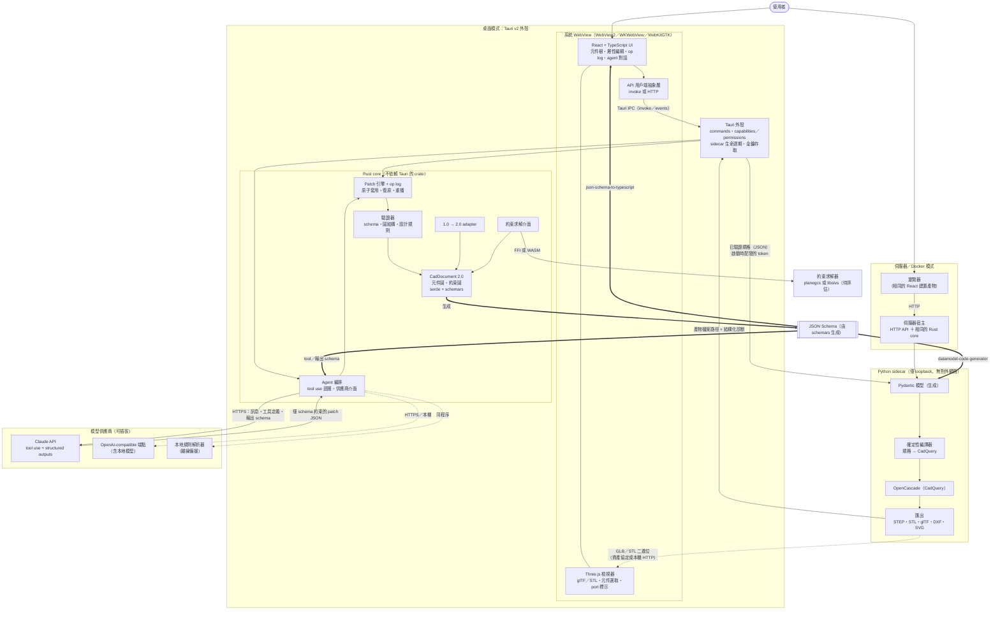

# 目標架構總覽

本文件彙整 [ADR 0002–0010](README.md) 所描述的**目標架構**（第 3 階段完成時的樣貌）。現行 v0.1.0 的實際架構請見 [`../ARCHITECTURE.md`](../ARCHITECTURE.md)；各階段的過渡狀態請見 [0010](0010-migration-phases.md)。

## 架構圖

圖例：實線為執行期呼叫；虛線為替代或二進位資料路徑；粗線為建置期的 schema 生成。伺服器宿主的具體形式尚未決定（見 [0005](0005-rust-core-document-model.md)）。

## 元件與責任

| 元件 | 語言／技術 | 責任 | 不負責 | ADR |
|---|---|---|---|---|
| Tauri 外殼 | Rust、Tauri v2 | 視窗、IPC、權限、sidecar 生命週期、金鑰存取 | 領域邏輯 | [0002](0002-desktop-shell-tauri-v2.md) |
| UI | React、TypeScript、Vite | 顯示與編輯；把修改轉為 patch 送出 | 文件的權威狀態、驗證規則 | [0003](0003-frontend-react-typescript.md) |
| 3D 檢視器 | Three.js | 顯示網格、元件選取、port 標示 | 幾何運算 | [0004](0004-3d-viewer-threejs.md) |
| Rust core | Rust、serde、schemars | 文件模型、元件圖、約束圖、驗證、patch、op log、adapter | B-rep 幾何、約束數值求解 | [0005](0005-rust-core-document-model.md) |
| 約束求解器 | planegcs 或 libslvs | 求解幾何約束並回報診斷 | 約束圖的儲存與結構檢查 | [0007](0007-constraint-solver.md) |
| Agent 編排 | Rust（HTTP 用戶端） | tool use 迴圈、供應商介面、重試與上限 | 直接修改文件（一律經 patch 引擎） | [0009](0009-agent-orchestration.md) |
| Python sidecar | Python、CadQuery、OCCT | 已驗證規格 → 幾何 → 匯出；幾何診斷 | 驗證設計、呼叫 LLM、對外網路 | [0006](0006-geometry-kernel-occt-python-sidecar.md) |
| Schema 管線 | schemars、datamodel-code-generator、json-schema-to-typescript | 由 Rust 型別生成 JSON Schema、Pydantic、TypeScript 與 LLM schema | 語意（跨欄位）驗證 | [0008](0008-single-schema-source-of-truth.md) |

## 主要資料流

### 使用者手動編輯

1. UI 把變更組成 patch，經 API 用戶端送到 Rust core。
2. Patch 引擎在副本上套用並由驗證器檢查；通過則提交並寫入 op log，否則整個拒絕並回傳診斷。
3. 文件有效時，Rust core 將已驗證規格送往 sidecar。
4. Sidecar 產生幾何並寫出 GLB 與所請求的匯出格式，回傳檔案路徑與幾何診斷。
5. 檢視器以二進位方式載入 GLB；診斷與驗證報告一併顯示。

### Agent 編輯

1. 使用者下達指令；編排模組將訊息、工具定義與 patch schema 送往模型供應商。
2. 模型以讀取類工具查詢文件，再以提交類工具送出 patch JSON。
3. Patch 走與手動編輯完全相同的閘門；失敗時診斷作為 tool result 回傳，模型修正後重試（有上限）。
4. 成功的 patch 以 agent 身分記入 op log；之後與手動編輯的第 3–5 步相同。

### 伺服器／Docker 模式

瀏覽器載入相同的前端建置產物，API 用戶端改用 HTTP；伺服器宿主執行相同的 Rust core 邏輯並呼叫相同的 Python 幾何服務。既有的 REST API 與 CLI 持續可用。

## 貫穿各層的不變原則

這些原則承襲自 v0.1.0，在目標架構中不得被削弱：

1. **LLM 不輸出程式碼。** 模型只能產生 schema 約束的資料（1.0 是整份文件，2.0 是 patch）；幾何由確定性編譯器建立。
2. **驗證閘門。** 存在 `error` 的文件不會送往幾何核心；`warning` 不阻擋但標記需人工覆核。
3. **嚴格的 schema。** 拒絕未知欄位；數值與集合大小有界；單位固定為 mm。
4. **幾何運算隔離。** 幾何核心在獨立程序中執行，有固定命令列、封閉工作目錄與 timeout，且不需對外網路。
5. **可重現與可追溯。** 同一份文件產生相同輸出；記錄 planner／agent、模型、核心版本等 provenance；金鑰不寫入任何產物。

## 已知風險彙整

| 風險 | 主要說明所在 |
|---|---|
| Sidecar 體積（Python + OCCT 約 300–500 MB；conda-pack／PyInstaller） | [0002](0002-desktop-shell-tauri-v2.md)、[0006](0006-geometry-kernel-occt-python-sidecar.md) |
| 跨語言 schema 漂移 | [0008](0008-single-schema-source-of-truth.md) |
| Windows WebView2（WebGL 可用）與其他平台 WebView 差異 | [0002](0002-desktop-shell-tauri-v2.md)、[0004](0004-3d-viewer-threejs.md) |
| 大型網格的 IPC 負擔 | [0004](0004-3d-viewer-threejs.md)、[0006](0006-geometry-kernel-occt-python-sidecar.md) |
| 約束求解器的授權與 3D 能力 | [0007](0007-constraint-solver.md) |
| 提示注入與金鑰管理 | [0009](0009-agent-orchestration.md) |

## 尚未決定的事項

| 事項 | 預計決定時點 | 來源 |
|---|---|---|
| planegcs 與 libslvs 的最終選擇 | 第 3 階段開始時 | [0007](0007-constraint-solver.md) |
| 伺服器模式下 Rust core 的宿主形式 | 第 2 階段開始時 | [0005](0005-rust-core-document-model.md) |
| 是否採用 three-cad-viewer | 第 1 階段期間 | [0004](0004-3d-viewer-threejs.md) |
| Sidecar 封裝方式（conda-pack 或 PyInstaller） | 第 1 階段期間 | [0006](0006-geometry-kernel-occt-python-sidecar.md) |
| 2.0 模型是否繼續支援 OpenSCAD 後端 | 第 2 階段期間 | [0006](0006-geometry-kernel-occt-python-sidecar.md) |
| 是否啟動第 4 階段（直接綁定 OCCT、移除 Python） | 第 3 階段完成後 | [0010](0010-migration-phases.md) |
